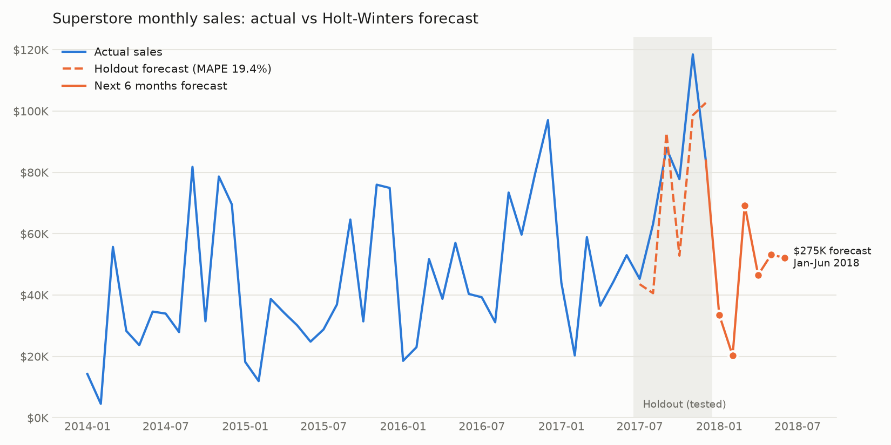

# Superstore Sales Analysis & Forecast

End-to-end analysis of the Tableau **Sample - Superstore** dataset (9,994 order lines, Jan 2014 - Dec 2017, US retail):
load raw data into PostgreSQL, answer business questions in SQL, forecast sales in Python, and visualize in Tableau.

**Tableau Public dashboard:** _[add link here]_



## Tools

- **PostgreSQL 17**: data storage, cleaning via typed schema, analysis (window functions `LAG()`, `RANK()`, CTEs, `HAVING`, `FILTER`)
- **Python** (pandas, statsmodels, matplotlib): Holt-Winters exponential smoothing forecast
- **Tableau Public**: interactive dashboard built from the exported CSVs

## Key insights

The business sold **$2.30M** with **$286.4K profit (12.5% margin)** over 4 years; sales grew **51%** from 2014 ($484K) to 2017 ($733K).

1. **Heavy discounts destroy profit.** Order lines discounted more than 20% are 13.9% of all lines but lost **$135.4K**,
   equal to 47% of the company's total profit. Margin falls from **29.5%** with no discount to **-15.3%** at 21-40% off
   and **-77.4%** above 40%. Recommendation: cap discounts at 20%.
2. **Furniture sells but barely profits.** $742K in sales at only a **2.5% margin**, vs ~17% for Technology and
   Office Supplies. **Tables (-$17.7K)** and **Bookcases (-$3.5K)** are loss-making, with average discounts of
   26.1% and 21.1% vs 15.6% company-wide.
3. **Central region has the weakest margin (7.9%)** vs West (14.9%). It sells $110K more than South yet earns
   less profit. Central also has the highest average discount (24.0% vs 10.9% in West); Texas and Illinois alone lost $38.3K.

Also: 98.5% of customers ordered more than once (99.8% of revenue), so retention is strong. The #1 customer by
revenue ($25.0K) was unprofitable (-$2.0K), which shows why revenue rankings should be read alongside profit.

**Forecast:** Holt-Winters (additive trend, multiplicative yearly seasonality) scored a **19.4% MAPE** on a 6-month
holdout (Jul-Dec 2017), beating a same-month-last-year baseline (25.4%). It forecasts **~$275K** in sales for Jan-Jun 2018.

## Project structure

```
data/superstore.csv          raw dataset (Windows-1252 encoded, as downloaded)
sql/load.sql                 creates the typed `orders` table and loads the CSV
sql/analysis.sql             analysis queries (commented) + CSV exports
notebooks/forecast.py        monthly sales forecast + chart
outputs/                     query results as CSV, clean full table, forecast chart
```

| Output file | Question it answers |
|---|---|
| `01a_sales_profit_by_region.csv` | Sales, profit, margin by region |
| `01b_sales_profit_by_category.csv` | Sales, profit, margin by category |
| `02_monthly_sales_growth.csv` | Monthly sales with month-over-month and year-over-year growth |
| `03_top10_customers.csv` | Top 10 customers by revenue |
| `04a_loss_making_subcategories.csv` | Sub-categories with negative total profit |
| `04b_discount_vs_profit.csv` | Profit margin by discount band |
| `05_repeat_vs_onetime_customers.csv` | Repeat vs one-time customers |
| `06_sales_forecast.csv` | Holdout test + 6-month forecast |
| `superstore_clean.csv` | Full clean table (UTF-8, ISO dates) for Tableau |

## How to run

Requires macOS with [Homebrew](https://brew.sh) and Python 3.

```bash
# 1. PostgreSQL
brew install postgresql@17
brew services start postgresql@17
export PATH="/opt/homebrew/opt/postgresql@17/bin:$PATH"
createdb superstore

# 2. Load data, run analysis, export CSVs (from the project root)
psql -d superstore -f sql/load.sql
psql -d superstore -f sql/analysis.sql

# 3. Forecast
python3 -m venv .venv
.venv/bin/pip install -r requirements.txt
.venv/bin/python notebooks/forecast.py
```

## Data notes

- Source: Tableau "Sample - Superstore" (US), 9,994 rows x 21 columns, one row per product line in an order.
- The CSV is Windows-1252 encoded with US-style dates (`11/8/2016`); `load.sql` handles both.
- `postal_code` is stored as text to keep leading zeros (e.g. Vermont `05408`).
- Sales and profit use `NUMERIC` (exact decimals) rather than floating point.
